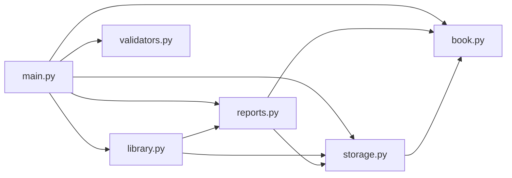
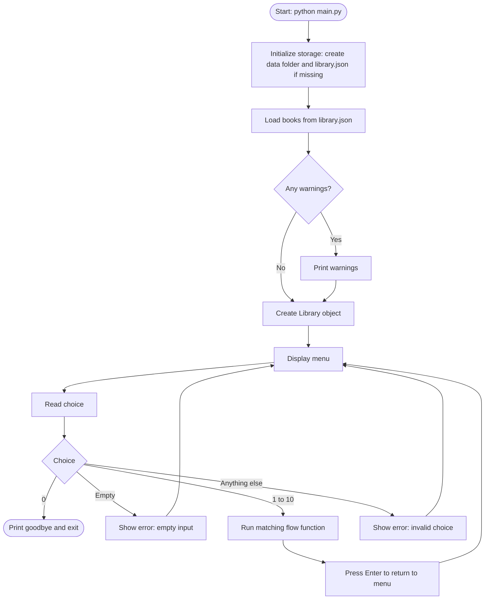
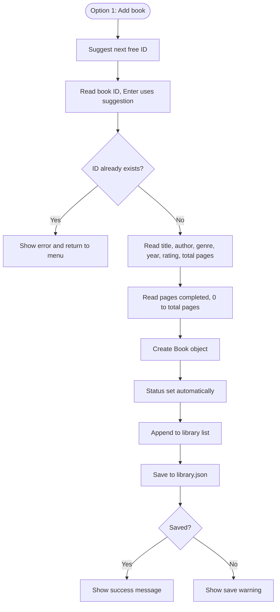
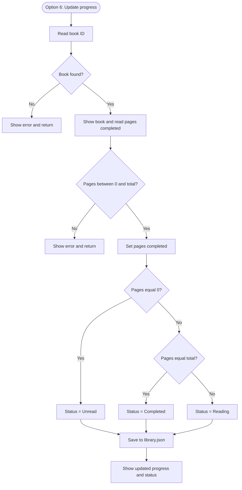
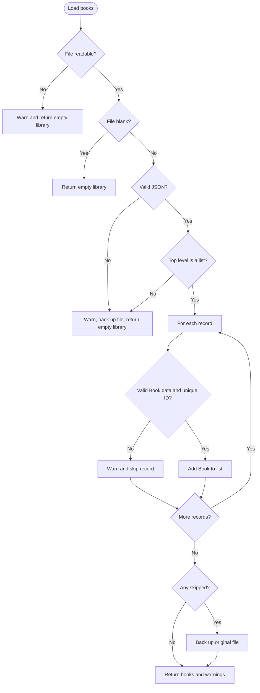
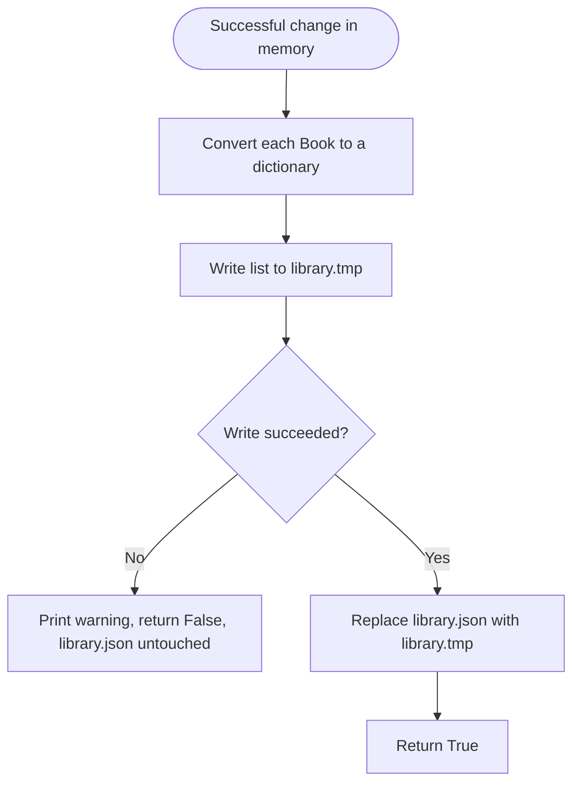

# Personal Library & Reading Tracker - Documentation

## 1. Overview

A terminal-based Python application for managing a personal book collection.
It supports adding, viewing, searching, updating, deleting and filtering books,
page-based reading progress with automatic status, statistics, CSV export and a
TXT reading report. Data is stored in JSON and saved automatically after every
successful change.

**Technology:** Python 3, built-in libraries only (`json`, `csv`, `pathlib`,
`shutil`, `datetime`, `math`).

---

## 2. Project Architecture

```
Personal-Library-Tracker/
├── main.py          # Menu loop, coordinates all modules
├── book.py          # Book class + STATUSES tuple
├── library.py       # Library class (collection operations)
├── storage.py       # JSON load/save
├── reports.py       # Statistics, CSV export, TXT report
├── validators.py    # Input validation functions
├── documentation.md
├── README.md
└── data/
    ├── library.json
    ├── library_export.csv
    └── reading_report.txt
```

### Module responsibilities

| Module | Responsibility |
|---|---|
| `main.py` | Displays the menu, reads the choice, calls the matching flow function, shows status messages, loops until exit. |
| `book.py` | Defines `Book` (attributes, completion %, progress update, detail update, `to_dict`) and the `STATUSES` tuple. |
| `library.py` | Defines `Library`: holds the list of books, add/search/update/delete/filter, progress updates, statistics, duplicate-ID prevention. |
| `storage.py` | Loads `library.json` into `Book` objects and saves books back safely. Handles missing, empty and malformed files. |
| `reports.py` | Calculates statistics, exports CSV, generates the TXT report. |
| `validators.py` | Reusable input functions that keep asking until the input is valid. |

### Import structure (no circular imports)



---

## 3. Data Model

### Book attributes

| Attribute | Type | Notes |
|---|---|---|
| `book_id` | int | Unique, 1 or higher |
| `title` | str | 1-100 chars, at least one letter or digit |
| `author` | str | Letters, spaces, `.` `'` `-` only |
| `genre` | str | Stored in Title Case |
| `year` | int | 1000 up to the current year |
| `rating` | float | 0 to 5 (0 means not rated) |
| `total_pages` | int | 1 to 10000 |
| `pages_completed` | int | 0 up to `total_pages` |
| `status` | str | One of `STATUSES`, set automatically |

### Reading statuses

```python
STATUSES = ("Unread", "Reading", "Completed")
```

### Status rules

| Condition | Status |
|---|---|
| `pages_completed == 0` | Unread |
| `0 < pages_completed < total_pages` | Reading |
| `pages_completed == total_pages` | Completed |

### JSON record format

```json
{
    "book_id": 1,
    "title": "Atomic Habits",
    "author": "James Clear",
    "genre": "Self-Help",
    "year": 2018,
    "rating": 4.5,
    "total_pages": 320,
    "pages_completed": 320,
    "status": "Completed"
}
```

---

## 4. Overall Program Flow



**Menu mapping:** 1 Add, 2 View, 3 Search, 4 Update details, 5 Delete,
6 Update progress, 7 Filter, 8 Statistics, 9 Export CSV, 10 Generate report,
0 Exit.

---

## 5. Algorithms

### 5.1 Application startup and main loop

```
START
  initialize_storage()
  books, warnings = load_books()
  print each warning
  library = Library(books)
  WHILE True:
      show menu
      choice = input().strip()
      IF choice == "0": print goodbye; BREAK
      IF choice == "": show error; CONTINUE
      action = actions.get(choice)
      IF action is None: show error; CONTINUE
      action(library)
      wait for Enter
END
```

If the user presses Ctrl+C or the input stream closes, the loop exits cleanly.

### 5.2 Input validation (all `get_*` functions)

```
FUNCTION get_int(prompt, minimum, maximum, allow_blank):
    WHILE True:
        text = read_input(prompt, allow_blank)
        IF text is empty: RETURN None          # only reachable if allow_blank
        TRY convert text to int
        EXCEPT ValueError: print error; CONTINUE
        IF below minimum or above maximum: print error; CONTINUE
        RETURN number
```

`get_float` follows the same steps and also rejects `nan` and `inf`.
`get_year`, `get_rating`, `get_page_count` and `get_progress` call these with
fixed limits. `get_title`, `get_author` and `get_genre` check length and allowed
characters. `get_yes_no` accepts y/yes/n/no only.

### 5.3 Add a book

```
1. suggested_id = highest existing ID + 1
2. Read book_id (Enter = suggested_id)
3. IF book_id already exists: show error; STOP
4. Read title, author, genre, year, rating, total_pages
5. Read pages_completed (0 to total_pages)
6. Create Book object (status is set automatically)
7. Append to library list
8. Save to JSON
9. Show success or error message
```



### 5.4 Automatic status update

```
FUNCTION refresh_status():
    IF pages_completed == 0:               status = "Unread"
    ELSE IF pages_completed == total_pages: status = "Completed"
    ELSE:                                   status = "Reading"
```

This runs inside `__init__`, `update_progress` and `update_details`, so the
status can never go out of sync with the page count.

### 5.5 Update reading progress

```
1. Ask for book ID; find the book (error if missing)
2. Read new pages_completed (0 to total_pages)
3. TRY book.update_progress(pages)
      - validate 0 <= pages <= total_pages
      - set pages_completed
      - refresh_status()
   EXCEPT ValueError: show message; STOP
4. Save to JSON
5. Show new pages, percentage and status
```



### 5.6 Update book details

```
1. Ask for book ID; find the book (error if missing)
2. For each field, read new value (Enter = keep current, returns None)
3. IF every value is None: print "No changes"; STOP
4. Compute new_rating and new_total (use old value where None)
5. Validate new_rating, new_total against current pages_completed
   (nothing is changed if validation fails)
6. Apply the provided changes; refresh_status()
7. Save to JSON
```

Reducing `total_pages` below `pages_completed` is rejected, so data stays valid.

### 5.7 Delete a book

```
1. Ask for book ID; find the book (error if missing)
2. Show the book; ask "Delete this book? (y/n)"
3. IF yes: remove from list; save to JSON; show success
   ELSE: print "Deletion cancelled"
```

### 5.8 Search

```
FUNCTION search_books(field, keyword):
    keyword = lowercase(keyword)
    results = empty list
    FOR each book in library:
        text = book.title IF field == "title" ELSE book.author
        IF keyword is a substring of lowercase(text): append book
    RETURN results
```

Search by ID uses `find_by_id`, which loops through the list and returns the
book with the matching ID, or `None`. Searching is case-insensitive and matches
partial text.

### 5.9 Filter

```
filter_by_genre(genre):  FOR each book: IF lowercase genre matches: append
filter_by_status(status): FOR each book: IF book.status == status: append
get_genres(): add each genre to a set; return sorted(set)
```

A set is used so each genre is listed once in the "Available genres" prompt.

### 5.10 Load books from JSON

```
FUNCTION load_books():
    TRY read file content
    EXCEPT OSError: warn; RETURN empty list
    IF content is blank: RETURN empty list
    TRY parse JSON
    EXCEPT JSONDecodeError: warn; back up original file; RETURN empty list
    IF parsed data is not a list: warn; back up; RETURN empty list
    seen_ids = empty set
    FOR each record:
        TRY convert record to Book
        EXCEPT KeyError, ValueError, TypeError: warn; skip record
        IF ID already in seen_ids: warn; skip record
        add ID to seen_ids; append book
    IF any record was skipped: back up original file
    RETURN books, warnings
```



Backups go to `data/library_backup.json`, so original data is never silently
lost.

### 5.11 Save books to JSON (safe write)

```
FUNCTION save_books(books):
    records = [book.to_dict() for each book]
    TRY
        write records to library.tmp
        replace library.json with library.tmp
        RETURN True
    EXCEPT OSError, TypeError, ValueError:
        print warning
        RETURN False
```

Writing to a temporary file first means a failed write cannot corrupt the
existing `library.json`.



### 5.12 Statistics

```
FUNCTION calculate_statistics(books):
    status_counts = {Unread: 0, Reading: 0, Completed: 0}
    genre_counts = {}
    FOR each book:
        status_counts[book.status] += 1
        genre_counts[book.genre] += 1
        total_pages += book.total_pages
        pages_completed += book.pages_completed
        IF book.rating > 0: add to rating_sum; rated_books += 1
    overall_progress = pages_completed / total_pages * 100   (0 if no pages)
    average_rating = rating_sum / rated_books                (0 if none rated)
    RETURN dictionary of all values
```

Unrated books (rating 0) are excluded from the average rating.

### 5.13 CSV export

```
1. Create data folder if needed
2. Open library_export.csv for writing
3. Write the header row
4. FOR each book: write one row, including completion percentage
5. Return success or error message
```

### 5.14 TXT report

```
1. Build header with the current date and time
2. Add the statistics section
3. FOR each status in STATUSES:
       list books with that status (ID, title, author, pages, %, rating)
4. Write all lines to reading_report.txt
5. Return success or error message
```

---

## 6. Error Handling Summary

| Situation | Handling |
|---|---|
| Invalid menu choice or empty input | Error message, menu shown again |
| Non-numeric input | Validator reprompts |
| Rating outside 0-5, invalid pages or year | Validator reprompts |
| Duplicate book ID | Add is refused with a message |
| Missing book ID | "No book found" message |
| Pages completed above total pages | Rejected by validator and `Book` |
| Missing or empty `library.json` | Created automatically or treated as empty |
| Malformed `library.json` | Warning, backup copy, empty library |
| Bad or duplicate records in JSON | Records skipped with a warning, backup made |
| File write or read errors | Caught with `OSError`, user told, app keeps running |
| Ctrl+C or closed input | Clean exit message |

---

## 7. Python Concepts Demonstrated

| Concept | Where used |
|---|---|
| Variables, numbers, strings, booleans | Throughout |
| Type conversion | `int()`, `float()`, `str()` in validators and `storage.dict_to_book` |
| Input and output | `input()` and `print()` in `main.py` and `validators.py` |
| Operators and conditionals | Status rules, validation checks |
| `for` and `while` loops | Searching, menu loop, input retry loops |
| `break` and `continue` | Menu loop and validators |
| Lists | `Library.books`, search results |
| Tuples | `STATUSES`, `CSV_HEADERS`, `NAME_SYMBOLS` |
| Sets | `get_genres`, duplicate-ID check when loading |
| Dictionaries | `to_dict`, menu `actions`, statistics |
| Functions, parameters, defaults, returns | All modules |
| Variable scope | Local variables in functions, constants at module level |
| Classes, `__init__`, attributes, methods | `Book`, `Library` |
| Exception handling | `try/except` in validators, storage, reports, library |
| TXT, CSV, JSON file handling | `reports.py`, `storage.py` |
| Serialization and deserialization | `json.dump`, `json.loads` |
| Modules and imports | Six modules working together |

---

## 8. How to Run

```
cd Personal-Library-Tracker
python main.py
```

Requires Python 3.6 or newer. No internet or installation of packages needed.

---

## 9. Testing Checklist

1. Run the app and view the library (option 2): 3 sample books appear.
2. Add a book with an existing ID: error expected.
3. Set pages to 0, partial and full: status goes Unread, Reading, Completed.
4. Exit and restart: changes persist.
5. Run options 9 and 10, then open the CSV and TXT files.
6. Replace `library.json` content with `{{{`: warning and backup expected.
7. Enter letters for numbers, an empty menu choice, and a rating of 7: no crash.
